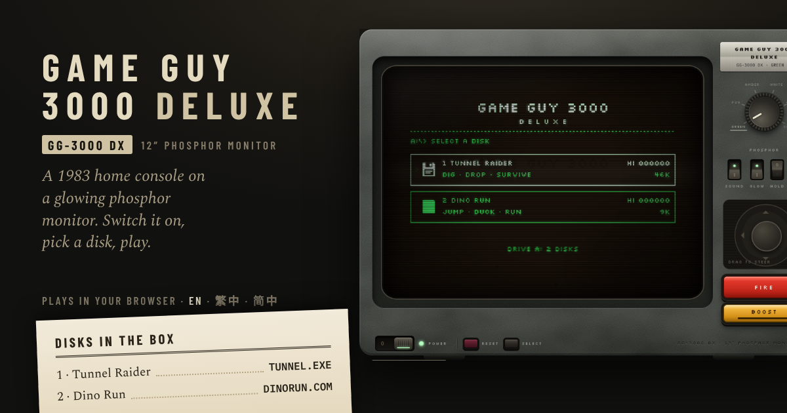

# Game Guy 3000 Deluxe



A 1983-style home console in the browser, on an old phosphor monitor. Switch it on, watch the BIOS and the floppy drive boot, pick a disk from the menu and play. Each game has its own loading screen, instructions and high-score table, and it all works offline once loaded.

## Games

| # | Game | File | Load time | What it is |
| --- | --- | --- | --- | --- |
| 1 | **Tunnel Raider** | `TUNNEL.EXE` | 4.4 s | Dig for emeralds, drop sacks of gold on the grubs and outwit smarter monsters every level. A tribute to Windmill Software's *Digger* (1983). |
| 2 | **Dino Run** | `DINORUN.COM` | 1.8 s | Jump the cacti and boulders, duck the pterosaurs, run as far as you can. A tribute to the offline dinosaur game in Google Chrome (2014). |

The characters, art, sound and code in both are original.

## The console

- **POWER** switches the set on (or press <kbd>Enter</kbd>). It runs a memory test, beeps, spins up the drive and boots the disk menu.
- **Disk menu:**
  - **Choose a game:** stick, arrow keys or <kbd>1</kbd>–<kbd>9</kbd>.
  - **Load it:** FIRE, <kbd>Space</kbd>, <kbd>Enter</kbd> or a tap on the disk.
- **Loading:** every disk shows a loading screen themed to its game and plays the drive (motor, head recalibrating, track steps, head parking) for exactly as long as it takes to read. Load times differ per game and never exceed 5 seconds.
- **SELECT** (graphite key, or <kbd>G</kbd>) warm-boots back to the disk menu from any game.
- **RESET** (wine-red key) restarts the whole console from the BIOS.
- **The phosphor dial and switches:**
  - **Dial:** green P1, long-afterglow green P39, amber P3, paper white P4 and the two CGA palettes.
  - **Switches:** SOUND, GLOW (all the tube effects), HOLD (pause) and FULL (full screen).
- **FIRE and BOOST** change with the game: FIRE and BOOST in Tunnel Raider, JUMP and DUCK in Dino Run.
- **Instructions:** the printed leaflet under the set shows the console's instructions while the menu is up and the loaded game's while you play.

### High scores

Each game keeps its own top ten on the device, in the browser's local storage, so scores survive offline play and restarts but never leave the device.

- **Entering a name:** a score that makes the table opens arcade-style name entry: up to nine letters and spaces, picked from an on-screen grid with the stick and FIRE, tapped, or typed.
- **After a game:** the game-over card and the table take turns on the screen.
- **Moving over from Tunnel Raider:** scores saved by the standalone Tunnel Raider on the same site are picked up automatically.

## Screens

A layout detector picks a layout from the viewport and input type:

| Layout | When |
| --- | --- |
| Desk | A mouse or trackpad |
| Console | A phone held sideways (gamepad style) |
| Tall console | A tablet or opened foldable held sideways |
| Phone portrait | An upright phone |
| Tablet portrait | An upright tablet |

The playfield's grid follows the shape of the tube.

## Languages

English (default), Traditional Chinese and Simplified Chinese, carried in the link: `#en`, `#zh-hant` (also `#zh-hk`, `#zh-tw`), `#zh-hans` (also `#zh-cn`, `#zh-sg`). Text on the tube stays English in the pixel font.

## Development

Built with **Vite + TypeScript** and plain Canvas 2D. There's no UI framework or game engine: the picture comes from our own four-colour, phosphor-afterglow CRT pass.

```sh
npm install
npm run dev        # local dev server
npm run build      # type-check, then build to dist/
npm run preview    # serve the build on http://localhost:4173
npm test           # unit tests (Vitest)
```

Browser checks use Playwright; they need Chromium and the `playwright` package installed (here the machine-wide copy is found with `NODE_PATH`):

```sh
npm run preview &
NODE_PATH=$(npm root -g) node tests/flow.cjs    # boot → menu → both games → SELECT → high scores, at three sizes
NODE_PATH=$(npm root -g) node tests/smoke.cjs   # Tunnel Raider plays and records a score
```

Both scripts load the page with `?test`, which exposes a small `window.__gg` hook for driving the game.

### Layout

```
index.html                    markup for the set and the instructions leaflet
src/main.ts                   entry: styles, console, web app, analytics
src/styles/console.css        the set, its layouts and the leaflet
src/console/core.ts           CRT picture, input, sound, switches, languages, scores, game loop
src/console/loader.ts         boot screens, disk menu, loading and drive sounds, SELECT
src/console/strings.ts        the console's own words in three languages
src/console/pwa.ts            install button, offline-ready and update prompts
src/games/types.ts            GameDisk: what every game gives the console
src/games/index.ts            the disks in loader order
src/games/tunnel-raider/      Tunnel Raider (game.ts) and its disk (loading screen, instructions)
src/games/dino-run/           Dino Run and its strings
public/                       icons, favicon, share image
```

### Adding a game

1. **Write the module:** create `src/games/<id>/` with a module that exports a `GameDisk` (see `src/games/types.ts`). It needs:
   - `start`, `update`, `draw`
   - a themed `drawLoad`
   - a `loadSecs` of 5 or less, and an uneven `steps` curve
   - `manual` sections and `strings` in `en`, `zh-hant` and `zh-hans`
2. **List it:** add the disk to `src/games/index.ts`.
3. **Keep top level clean:** don't use console imports at a game module's top level, only inside its functions. The modules import each other, and the console finishes loading after the games.

The unit tests check every disk's load time, progress curve and translations.

### Offline and updates

`vite-plugin-pwa` (Workbox) generates the service worker and manifest at build time and precaches every built file by content hash, so each deploy is a new offline version. When a new version has downloaded, the set's status badge offers a RESTART instead of interrupting a game. On HTTPS the browser can install it as an app.

## Analytics

[Vercel Web Analytics](https://vercel.com/docs/analytics) through `@vercel/analytics`: page views plus these custom events. Custom events need a Pro or Enterprise plan; on Pro each event carries at most two properties, so every event stays within two. Nothing personal is sent. Events appear under **Analytics → Events** in the Vercel dashboard.

| Event | Properties | When |
| --- | --- | --- |
| `power_on` | `theme`, `layout` | The set is switched on |
| `game_load` | `game`, `layout` | A disk is loaded from the menu |
| `game_start` | `game`, `layout` | A new game begins |
| `game_over` | `game`, `score` | A game ends |
| `new_best` | `game`, `score` | A game beats this device's best for that game |
| `high_score` | `game`, `rank` | A name goes on a game's table |
| `select` | `game`, `level` | SELECT is pressed (`game` is `menu` from the menu) |
| `reset` | `game`, `mode` | RESET is pressed |
| `level_cleared` | `level`, `how` | Tunnel Raider: a level ends by `emeralds` or `grubs` |
| `sunstone` | `level` | Tunnel Raider: the sunstone is picked up |
| `life_lost` | `level`, `cause` | Tunnel Raider: a cart is lost to a `sack`, `grub`, `borer` or `rockjaw` |
| `theme` | `theme`, `via` | The phosphor changes by `dial` or `key` |
| `language` | `lang` | The leaflet's language changes |
| `instructions_open` | `layout` | The instructions are opened |
| `fullscreen` | `on`, `layout` | Full screen is toggled |
| `launch_installed` | `layout` | Opened as an installed app |
| `install_prompt` | `outcome` | The install prompt is `accepted` or `dismissed` |
| `app_installed` | | The app was installed |
| `offline_ready` | | First cached for offline play |
| `update_applied` | | A player restarted into a new version |

## Deploy

Vercel detects Vite: build command `npm run build`, output directory `dist`. Any static host works the same way. Turn on Web Analytics in the project for the events above.

Once the console has its own address:
- **Share tags:** set the share tags in `index.html` (`og:url`, absolute `og:image` and `twitter:image`).
- **Canonical link:** add a canonical link.
- **Refresh Facebook's cache:** paste the address into Facebook's Sharing Debugger and press **Scrape Again**.

## Credits

Tunnel Raider is a tribute to Windmill Software's *Digger* (1983); Dino Run is a tribute to the offline dinosaur game in Google Chrome (2014). Both are original work: no characters, art, sound or code are copied.
