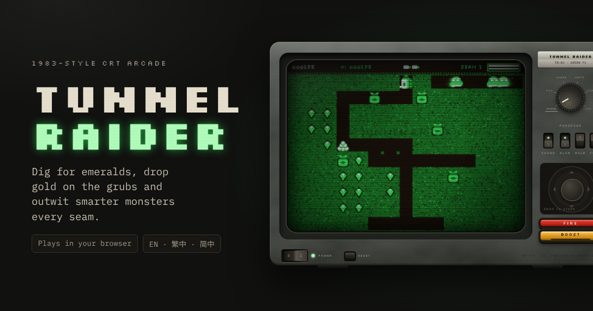

# Tunnel Raider

A tunnelling arcade game for the browser, played on a 1983-style CRT monitor. Dig for emeralds, drop sacks of gold on the grubs and outwit monsters that get smarter every seam.

It is one self-contained `index.html`: no build step, no dependencies beyond two Google Fonts.

## Play

Open `index.html` in a browser, or serve the folder with any static host (see [Deploy](#deploy)). The set starts switched off: flip **POWER** (or press <kbd>Enter</kbd>) to boot it.

| Action | Keyboard | On the set |
| --- | --- | --- |
| Move and dig | Arrow keys or <kbd>WASD</kbd> | Joystick (drag) |
| Throw a spark | <kbd>Space</kbd> or <kbd>Z</kbd> | FIRE |
| Speed boost | <kbd>Shift</kbd> or <kbd>B</kbd> | BOOST |
| Pause | <kbd>P</kbd> or <kbd>Esc</kbd> | HOLD switch |
| Sound on / off | <kbd>M</kbd> | SOUND switch |
| Change monitor | <kbd>C</kbd> | PHOSPHOR dial |
| Full screen | <kbd>F</kbd> | FULL switch |
| Power / reboot | <kbd>Enter</kbd> to power on | POWER switch, RESET button |

### Scoring

| | Points |
| --- | --- |
| Emerald | 25 |
| Eight emeralds in quick succession | +250 |
| Gold from a sack that fell two or more cells | 500 |
| Grub crushed by a sack or hit by a spark | 250 |
| Rockjaw (from seam 4) | 500 |
| Sunstone | 1,000 |
| Grubs rammed while the sunstone glows | 200 · 400 · 800 · 1,600 |
| Spare drill cart | every 20,000 |

### How it gets harder

- Grubs start slow and quicken every seam, but stay below the cart's open-tunnel speed. From seam 9 the cart speeds up too, and the cap rises with it.
- Grubs wander less, turn into tunnelling borers sooner and stay borers longer.
- From seam 3, borers shove sacks sideways and line them up over your cart.
- From seam 4, rockjaws dig their own tunnels and take two hits (three from seam 7).

## The monitor

- **Phosphor dial:** green (P1), long-afterglow green (P39), amber (P3), paper white (P4) and the two four-colour CGA palettes. Each phosphor fades at its own rate.
- **Tube effects:** scanlines, bloom, afterglow trails, a colour stripe mask, magnetised patches that creep back after each degauss, burn-in, dust, picture tears. The GLOW switch turns them all off.
- **Cold boot:** BIOS memory test, POST beep and a floppy load with drive sounds, all synthesised with the Web Audio API.

## Screens

A small detector picks a layout from the real viewport and input type, so it fits any phone, tablet or desktop:

| Layout | When | What you get |
| --- | --- | --- |
| Console | Touch screen held sideways | Joystick left, tube centre, dial and keys right |
| Phone portrait | Upright phone, or a tall narrow window | The set fills the screen, with a tall playfield |
| Tablet portrait | Upright tablet | Large tube, controls underneath |
| Desk | Mouse or trackpad | The full set with the guide below |

The playfield grid is chosen per game to match the tube's shape: about 15 × 10 on a wide screen, 10 or 11 columns by 14 to 16 rows on an upright phone.

## Languages

English (default), Traditional Chinese and Simplified Chinese. The language travels in the link, so you can share it:

- `…/#en`
- `…/#zh-hant` (also `#zh-hk`, `#zh-tw`)
- `…/#zh-hans` (also `#zh-cn`, `#zh-sg`)

## Deploy

The page's share tags assume GitHub Pages at `https://wiiiimm.github.io/tunnel-raider/`. To publish there, open **Settings → Pages**, choose **Deploy from a branch**, and select `main` / root. If you host it elsewhere, update the `og:url`, `og:image`, `twitter:image` and `canonical` URLs at the top of `index.html`.

## Credits

A tribute to Windmill Software's *Digger* (1983). The characters, artwork, sound and code here are original.
